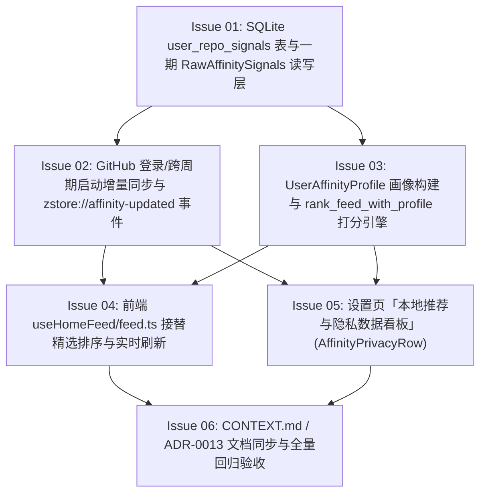

# 本地用户画像与 Catalog 动态推荐 · 开发计划

Status: ready-for-agent
Scope: 一期严格基于用户 GitHub Stars/Forks 仓库特征、应用内 Stars/Favorites/Watch 以及候选应用自身的 Stars/Forks 在本地构建推荐画像，并在设置页提供「本地推荐与隐私数据看板」（点击、浏览、停留时长等延后至二期；不做 300 条目规模下的冗余本地搜索缓存）

## 1. 核心决策锁定

| 编号 | 决策项 | 结论 |
|---|---|---|
| **D1** | 计算与存储位置 | **100% 客户端本地（Rust + SQLite `z_store.db`）**，零新增后端服务或第三方遥测，遵循 `CONTEXT.md` D2 原则 |
| **D2** | 首页呈现方式 | **直接接替现有发现页（`HomeView`）的「经典精选开源软件」与「全部精选开源收录」**，不额外堆砌独立板块或策略切换栏 |
| **D3** | GitHub 信号同步与跨周期保鲜 | **首次登录 + 跨周期启动增量同步**：OAuth 登录成功 / 设置 PAT / 手动同步 Star 时触发；当用户半个月或数天后再次打开应用时，启动时检查 `affinity_github_synced_at`（6 小时冷却窗口）并通过 `api_etag_cache`（`If-None-Match` HTTP 304 零配额）自动拉取最新 GitHub Stars 与 Forks |
| **D4** | 一期 vs 二期范围边界 | **一期（本期实现）**：仅使用 GitHub 账号 `stars` / `forks` 仓库特征、本应用内 `user_stars` / `user_favorites` / `watched_apps`、Catalog 应用自身的 `stars` 与 `forks`，以及设置页**本地推荐与隐私数据看板**。 **二期（延后不做）**：点击记录（`view_history`）、搜索历史（`search_history`）、页面停留时长（Dwell Time）等隐式交互行为。 **明确不做**：本地 Catalog 搜索缓存（约 300 条目直接扫描已足够高效） |
| **D5** | 隐私透明与用户控制 | 在设置页「数据管理与备份」（`DataManagementSection`）中新增**本地推荐与隐私数据看板（`AffinityPrivacyRow`）**，可视化展示本地信号构成与 Top 偏好分类/语言，支持一键启停（`enable_local_affinity`）、立即增量同步、一键清空本地画像 |
| **D6** | IPC 对齐门禁 | 新增的画像摘要/重置命令在 `src/services/api.ts` (`CMD`)、`src-tauri/src/lib.rs` (`generate_handler!`) 与 `src/services/api/demoMock.ts` 三处严格同步注册，保证 `cmdAlignment.test.ts` 与 `ipcArgsNaming.test.ts` 100% 通过 |

---

## 2. 产品不变量（验收口径）

- **I1 冷启动与关闭态零退化**：当用户未登录且无任何应用内 Star / 收藏 / Watch 记录，或在隐私看板中关闭 `enable_local_affinity` 时，排序结果与原 `balanced` 策略保持确定性一致。
- **I2 零阻塞首屏**：`get_home_feed` 仅从本地 SQLite 与内存 `CatalogService` 读取信号并在微秒级完成打分，绝不在 `get_home_feed` 内发起任何网络请求。
- **I3 跨周期增量刷新与配额卫生**：用户隔半个月再打开应用时，启动钩子检测到距上次 `affinity_github_synced_at` 已超 6 小时，自动携带 `api_etag_cache` 中的 `If-None-Match` 头请求 `/user/starred` 与 `/user/repos?type=owner`；远端无变化返回 `304 Not Modified` 时零配额消耗，有新增 Star/Fork 时静默更新本地画像并通知首页重排。
- **I4 账号隔离与一键重置**：执行 `oauth_logout` 退出登录或在隐私看板点击「清空本地画像」时，清空 `user_repo_signals` 与 `affinity_github_synced_at` 并立即通知首页恢复默认排序。
- **I5 种子推新**：已收藏（`user_favorites`）与已关注（`watched_apps`）的应用提升所属分类与开发者亲和度，同时自身施加 `-1.2` 适度让位降权，使同领域尚未被用户收藏的优质应用优先进入首页前 4「经典精选」展位。
- **I6 视图层 IPC 门禁**：`src/views/` 与 `src/components/` 严禁直接导入 `@tauri-apps/api/*` 或 `services/api/client`（`noDirectInvoke.test.ts` 强制卡点），事件订阅统一封装于 `src/services/feed.ts`。

---

## 3. 分阶段实施路线图（一期）

### P1 · 数据层（Issue 01）
- 文件：`src-tauri/src/db/schema.rs`、`src-tauri/src/db/affinity.rs`（新建）、`src-tauri/src/db/mod.rs`
- 交付：`user_repo_signals` 表 DDL、`UserRepoSignal` / `RawAffinitySignals` 结构体（一期仅聚合 `user_repo_signals`、`user_stars`、`user_favorites`、`watched_apps`，不读 `view_history` / `search_history`）、批量事务写入/按关系替换/登出清理/一次性读取方法及内存库单测。

### P2 · 同步与事件通道（Issue 02）
- 文件：`src-tauri/src/github/models.rs`、`src-tauri/src/github/affinity.rs`（同步部分）、`src-tauri/src/lib.rs`、`src-tauri/src/commands/oauth.rs`、`src-tauri/src/commands/forge.rs`
- 交付：`GitHubRepoResponse` 补充 `fork: Option<bool>`；实现 `CatalogService::sync_github_affinity_signals`（ETag 条件请求拉取 `/user/starred` 与 `/user/repos?type=owner`）；接入首次登录、跨周期启动（6h 冷却检查）、Star/Unstar、收藏（`toggle_favorite`）与关注（`watch_app` / `unwatch_app`）的 `GLOBAL_AFFINITY_TX` (`zstore://affinity-updated`) 广播。

### P3 · 画像与重排引擎（Issue 03）
- 文件：`src-tauri/src/github/affinity.rs`、`src-tauri/src/github/catalog_feed_score.rs`、`src-tauri/src/commands/catalog_feed.rs`、`src-tauri/src/commands/settings.rs`
- 交付：`UserAffinityProfile::from_signals`、10 大分类关键词与语言推断器 `infer_categories_from_repo`、应用自身 `stars` + `forks` 双因子基线 `feed_stars_forks_base`、`rank_feed_with_profile`，支持 `enable_local_affinity` 设置项控制，并在 `get_home_feed` 中启用。

### P4 · 前端精选接替与联动（Issue 04）
- 文件：`src/services/feed.ts`、`src/views/HomeView/useHomeFeed.ts`、`src/views/HomeView.tsx`、`src/services/feed.test.ts`
- 交付：`useHomeFeed` 在后端就绪时以 `backendItems` 同时驱动「经典精选开源软件」（Top 4）与「全部精选开源收录」（后续分页），前端本地 `buildFrontendAffinityScorer` 基于 `{ catalog, favoriteIds, watchedIds }` 同构兜底，订阅 `zstore://affinity-updated` 自动重拉。

### P5 · 本地推荐与隐私数据看板（Issue 05）
- 文件：`src-tauri/src/commands/catalog_feed.rs`、`src-tauri/src/lib.rs`、`src/services/api.ts`、`src/services/api/catalog.ts`、`src/services/api/demoMock.ts`、`src/components/AffinityPrivacyRow.tsx`（新建）、`src/views/SettingsView/sections/DataManagementSection.tsx`、`src/i18n/locales/zh.json`、`src/i18n/locales/en.json`
- 交付：新增 `get_affinity_profile_summary` 与 `reset_affinity_profile` 命令；在设置页「数据管理与备份」分组内渲染本地隐私数据看板，展示本地 Star/Fork/收藏/Watch 信号计数、Top 3 偏好分类与编程语言、最近同步时间，并提供个性化推荐开关、手动增量刷新与一键清空画像按钮。

### P6 · 文档与门禁收口（Issue 06）
- 文件：`CONTEXT.md`、`docs/adr/0013-feed-contract.md`
- 交付：更新领域词汇表与 ADR-0013 说明，跑通 `cargo test`、`cargo clippy`、`npx tsc --noEmit`、`npx vitest run`。

---

## 4. 二期展望（Deferred to Phase 2 · 本期不实现）

1. **轻量点击流与浏览画像**：将 `view_history`（点击打开详情页）与 `search_history`（搜索词）作为低权重短期兴趣因子融入 `UserAffinityProfile`。
2. **停留时长（Dwell Time）信号**：在详情页记录有效阅读时长，过滤误触点击噪音。

---

## 5. 风险与缓解

- **R1 单一分类过度垄断首屏**：若用户只 Star 或 Watch 了 1 款某分类软件，未加平滑的线性权重会导致该分类霸占全部 20 个席位。
  - *缓解*：采用 `conf = 1 - exp(-v / tau)` 软饱和函数控制单次信号置信度上限，并保留应用自身 `ln(stars + 1) + 0.25 * ln(forks + 1)` 质量分作为底座。
- **R2 Fork 仓库命名空间偏移**：用户在 GitHub Fork 的仓库 `full_name` 为 `<user>/<repo>`，与 Catalog 中的 `<upstream>/<repo>` 不同。
  - *缓解*：对 `relation == "forked"` 的信号，除尝试匹配 `full_name` 外，额外按 `<repo>` 名称反查 `CatalogService` 中的上游条目。
- **R3 视图层违规引入 `@tauri-apps/api/event` 或 `CMD` 注册表失配**：会导致 `noDirectInvoke.test.ts` 或 `cmdAlignment.test.ts` 失败。
  - *缓解*：事件监听统一封装在 `src/services/feed.ts::subscribeAffinityUpdated` 中；新增命令在 `api.ts`、`lib.rs`、`demoMock.ts` 同步登记并跑门禁单测验证。
