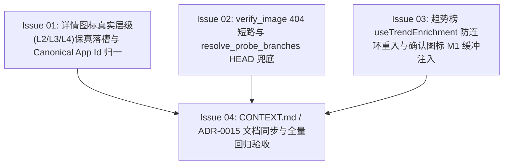

# 富卡列表与详情页 L3/L4 多级图标探索一致性修复 · 开发计划

Status: resolved
Scope: 修复趋势榜与在线搜索富卡列表无法展示 L3 图标、详情页将 L4 README 图标误标为 L3、趋势榜 enrich 重入杀死后台图标流、以及确认图标 `data:` 回填丢失与 ID 大小写未归一问题。

---

## 1. 核心决策锁定

| 编号 | 决策项 | 结论 |
|---|---|---|
| **D1** | 详情页 L2/L3/L4 来源归属 | `fetch_app_detail` 显式区分 `probed_hit`（`simple-icons` → L2，`trees` → L3）与 `extracted_logo`（README → L4）；README 命中的 Logo 必须以 `level = 4` 落入 `l4_url`，禁止因 `clean_image_url` 剥除 `/blob/` 而误落 `l3_url` |
| **D2** | 详情页 L2/L3 与 L4 并发双命中 | 当详情页 `probed_hit`（L2/L3）与 `extracted_logo`（L4）同时命中时，主展示采用高优的 L2/L3，同时通过 `fill_probe_slot(&mut cycle, 4, &l4)` 将 L4 填入备选槽，使详情页手动轮换天然具备完整 `L2 -> L3 -> L4 -> L5` 档位 |
| **D3** | L2 SimpleIcons 404 快速失败 | `icon_probe::verify_image` 在 `HEAD` 或 `Range GET` 收到 `404 Not Found` / `410 Gone` 时立即短路返回 `None`，消除每 slug 3 次串行 404 请求放大；保持 `config::api_timeout_or` 现有语义不变（不破坏 ADR-0015 与 `config.rs` 单测） |
| **D4** | L3 Trees 分支解析韧性 | `icon_probe::resolve_probe_branches` 在 `/repos/{owner}/{repo}` 请求失败、超时或缺失 `default_branch` 时回退返回 `vec!["HEAD".to_string()]`（对齐详情页 `detail_fetch.rs` 的 `"HEAD"` 兜底），避免因单次元数据抖动直接跳过 L3 |
| **D5** | 趋势榜 `BOARD_GEN` 稳定性 | `useTrendEnrichment` 按 `(trendResult, activeBoard)` 周期记录 `attemptedEnrichKeysRef`，不再因 `displayItems` / `enrichedApps` 更新或单仓 `fetch_online_repo` 失败而重复触发 `enrich_trend_repos`，确保单次加载只递增一次 `BOARD_GEN` |
| **D6** | 确认图标 `data:` 与缓存边界 | 保持 `trendEnrichCache` 与 `trend_board_cache` 严禁持久化 `data:` 的既有契约（锁死 `enrich.simplify.test.ts` 与 `swr-view.test.tsx`）；在 `enrichTrendReposCore` 收到 `data:` 确认图标时通过 `admitIconHit({ via: 'm2' })` 写入 `iconStore` M1 内存缓冲，使 `resolveIconWithBuffer` 与 `AppIcon` 即时可读 |
| **D7** | `Canonical App Id` 全链路小写 | `fetch_online_repo`、`get_or_fetch_icon`、`load_or_new_cycle` 统一将 `app_id` 归一为小写 `owner/repo`（ADR-0010），根除 `app_icon_cycles` 大小写重复行 |

---

## 2. 产品不变量（验收口径）

- **I1 级别诚实性**：从 README 提取的首部图片在 `app_icon_cycles` 中恒为 `level = 4`（落 `l4_url`），Git Trees 命中的仓库图标恒为 `level = 3`（落 `l3_url`），SimpleIcons 恒为 `level = 2`（落 `l2_url`）。
- **I2 轮换完整性**：未收录应用若同时具备 L3（仓库树）与 L4（README）图标，在详情页点击轮换按钮可依次经历 `L3 -> L4 -> L5 -> L3`，不再跳过 L4。
- **I3 列表 L3 探测可达性**：SimpleIcons 返回 404 时单 slug 仅产生 1 次 `HEAD` 请求；`/repos/{owner}/{repo}` 偶发失败时 `probe_l3_trees` 自动以 `"HEAD"` 探测 Git Trees。
- **I4 趋势流式不自杀**：同榜存在个别 `fetch_online_repo` 返回 `null` 的仓库时，`useTrendEnrichment` 不会对同一榜单周期重复调用 `enrichTrendRepos`，后台 `fetch_icons_stream` 不会被同榜重入取消。
- **I5 既有门禁零回归**：`enrich.simplify.test.ts`、`swr.test.ts`、`swr-view.test.tsx`、`HomeView.search-icon.test.tsx`、`cmdAlignment.test.ts`、`ipcArgsNaming.test.ts`、`noDirectInvoke.test.ts` 及 `cargo test` 100% 通过。

---

## 3. 分阶段实施路线图

### P1 · 后端详情图标分级与 ID 归一（Issue 01）
- 文件：`src-tauri/src/db/icon_cycle.rs`、`src-tauri/src/github/icon_fetch.rs`、`src-tauri/src/github/detail_fetch.rs`、`src-tauri/src/commands/catalog_detail.rs`、`src-tauri/src/commands/icons.rs`、`src-tauri/src/commands/icons_cycle_probe.rs`、`src-tauri/src/github/search.rs`、`src-tauri/src/db/tests.rs`
- 交付：
  - `pick_detail_icon_with_level`（或保留 `pick_detail_icon` 并新增带级别返回版本）精准区分 L1/L2/L3/L4 来源；
  - `persist_github_detail` 按真实来源级别调用 `merge_detail_icon`，并在 L2/L3 命中且存在 `extracted_logo` 时通过 `fill_probe_slot(&mut cycle, 4, &l4)` 补齐 `l4_url`；
  - `AppIconCycle::level_for_known_url` + `level_for_detail_icon` 识别 `/HEAD/` 与 README 图床域名；
  - `fetch_online_repo`、`get_or_fetch_icon`、`load_or_new_cycle` 统一归一小写 `app_id`。

### P2 · 后端 L2/L3 探测加速与分支兜底（Issue 02）
- 文件：`src-tauri/src/github/icon_probe.rs`
- 交付：
  - `verify_image` 与 `fetch_range_head` 抽出纯状态码判定函数 `is_terminal_http_miss(status: reqwest::StatusCode) -> bool`（`404` / `410` 返回 `true`），在 `HEAD` 与 `Range GET` 收到 `404`/`410` 时立即返回 `None`；
  - `resolve_probe_branches` 在远端获取 `default_branch` 失败/超时/为空时回退返回 `vec!["HEAD".to_string()]`，并补齐单测。

### P3 · 前端趋势榜防重入与确认图标 M1 注入（Issue 03）
- 文件：`src/views/TrendsView/useTrendEnrichment.ts`、`src/services/trends/board.ts`、`src/services/trends/enrich.ts`、`src/services/trends/swr-view.test.tsx`
- 交付：
  - `useTrendEnrichment` 引入按榜单加载周期隔离的 `attemptedEnrichKeysRef`，避免因 `displayItems` 变动或单仓 enrich 返回 `null` 触发连环 `enrichTrendRepos` 重入；
  - `enrichTrendReposCore` 对后端返回的非空 `s.icon`（含 `data:` 确认图标）调用 `admitIconHit({ id: key, icon: s.icon, via: 'm2' })` 写入 M1 缓冲（保持不进 `trendEnrichCache` 的契约不变）；
  - 新增单测锁定“单仓 enrich 返回 `null` 时不二次触发 `enrichTrendRepos`”与“确认图标 `data:` 经 M1 缓冲直显”。

### P4 · 文档同步与全量回归验收（Issue 04）
- 文件：`CONTEXT.md`、`docs/adr/0015-unified-icon-fetch-and-search-alignment.md`
- 交付：同步更新 `CONTEXT.md` D10 与 `ADR-0015` §2/§3/§6 中关于 `resolve_probe_branches` 失败回退 `"HEAD"` 及详情 L4/L3 落槽口径的描述，执行全量 Rust 与前端测试门禁。
